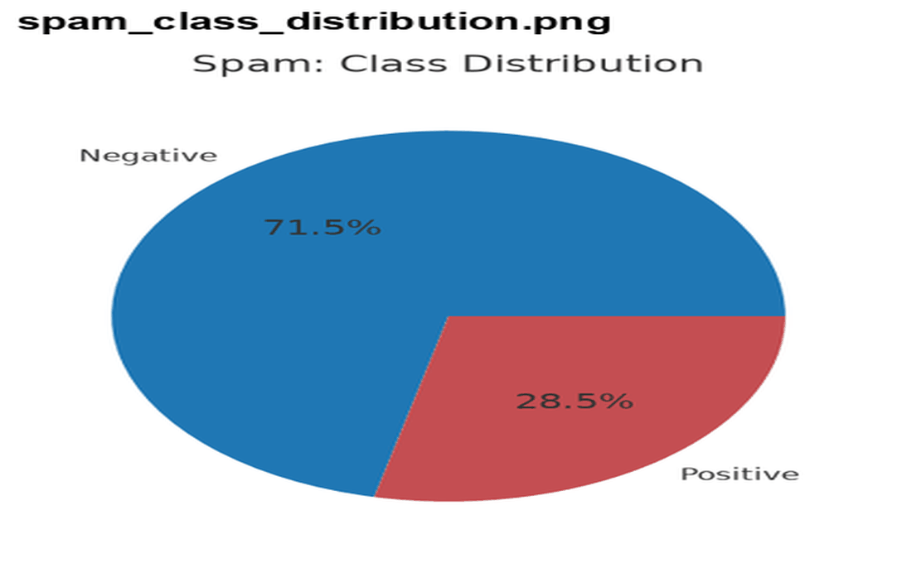
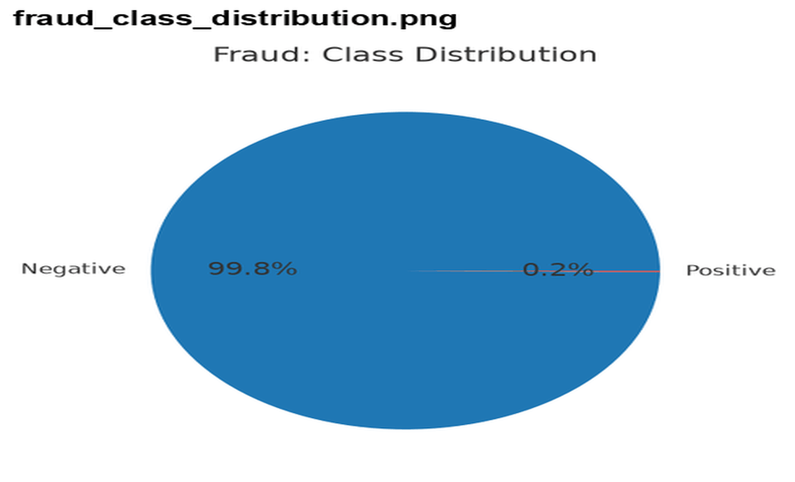
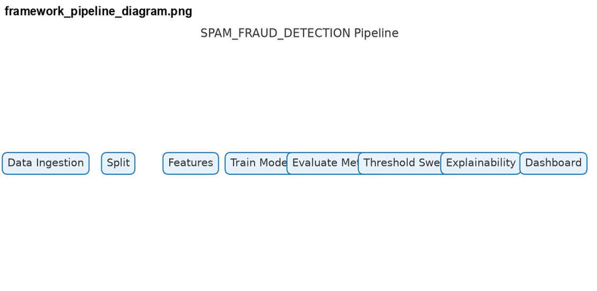
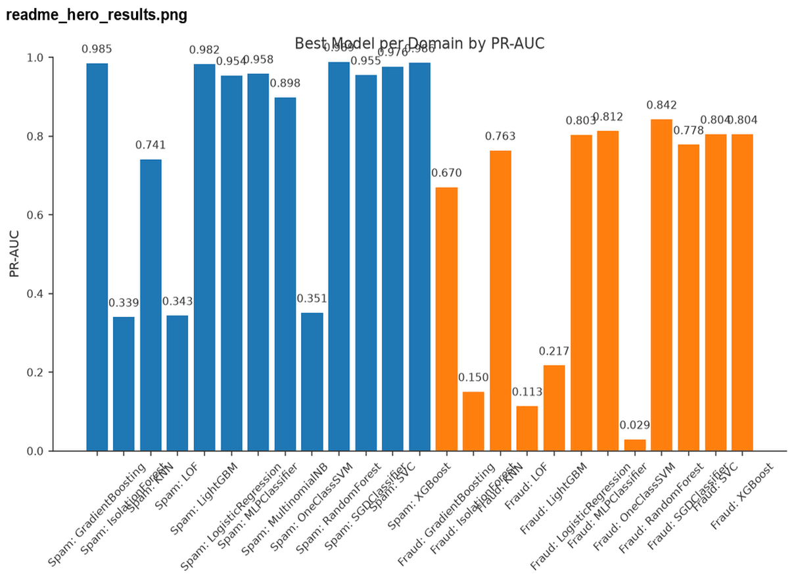

# Binary Classification Benchmarking Framework
### Reproducible Model Comparison for Spam & Credit-Card Fraud Detection

[](https://github.com/GuyKaptue/spam-fraud-detector/actions/workflows/ci.yml)
[](https://github.com/GuyKaptue/spam-fraud-detector/actions/workflows/release.yml)
[](https://github.com/GuyKaptue/spam-fraud-detector/actions/workflows/security.yml)
[](https://codecov.io/gh/GuyKaptue/spam-fraud-detector)
[](https://pypi.org/project/spam-fraud-detector/)
[](https://pypi.org/project/spam-fraud-detector/)
[](LICENSE)
[](https://doi.org/10.5281/zenodo.XXXXXXX)

**Author:** Guy M. Kaptue T. — [GitHub](https://github.com/GuyKaptue) — guykaptue24@gmail.com
**License:** MIT · **Version:** 5.0.0 · **Python:** ≥3.9

---

## 1. Executive Summary

A production-grade machine learning experimentation, explainability, statistical validation, and model governance framework for spam and credit-card fraud detection. The platform combines reproducible benchmarking, MLflow experiment tracking, statistical significance testing (McNemar test with Holm correction, effect-size estimation), SHAP-based explainability, anomaly detection, and automated evidence-based reporting. All documentation is generated from actual experimental outputs, ensuring full reproducibility, traceability, and auditability suitable for both academic research and regulated industry environments.

## 2. Business Problem

Binary classifiers behave very differently under class imbalance and feature scaling. This framework makes the trade-offs measurable, visual, and reproducible:

- **Spam**: false positives (legitimate mail blocked) vs. false negatives (spam delivered)
- **Fraud**: false positives (declined customers) vs. false negatives (missed fraud — costly)

Both domains are framed against anomaly detection, since rare-positive problems are fundamentally anomaly problems.

## 3. Architecture Overview

```
Data Ingestion ──▶ Split Manager ──▶ Feature Engineering ──▶ Model Training
                                                      │
                                      ┌───────────────┴───────────────┐
                                      ▼                               ▼
                              Statistical Validation ─────────▶ Explainability
                                      │                               │
                                      ▼                               ▼
                              Model Selection ─────────────▶ Reporting
```

| Layer | Component | Contract |
|---|---|---|
| Data | `KaggleDataLoader` | Download, cache, prepare Kaggle datasets; idempotent; column schema validation |
| Experiment | `ClassifierGroupComparer` | Split, train scaled & unscaled groups, collect metrics |
| Reporting | `ModelVisualizer` | Confusion matrices, F1 bars, group comparison, ROC & PR curves, Excel/PDF |
| Tracking | MLflow | params, metrics, tags per run; experiment store in `mlruns/` |
| Evidence | `ResultStore` + `render_doc_figures.py` | Artifact persistence; deterministic figure rendering from `docs/EVIDENCE_INVENTORY.json` |
| Explainability | `ModelExplainer`, `TextExplainer`, `AnomalyExplainer` | SHAP explanations, waterfall plots, case files |

## 4. Datasets

| Domain | Dataset | Positive class | Positive rate | Test samples | Primary metric |
|---|---|---|---|---|---|
| Spam Detection | Kaggle Spam Mails | Spam | 27.7% (214/773) | 773 | PR-AUC |
| Fraud Detection | Kaggle Credit Card Fraud | Fraud | 0.17% (60/34,857) | 34,857 | PR-AUC / AUPRC |

Both datasets use stratified train/test splits with fixed `random_state=42`. All models are evaluated on identical holdout test sets under scaled and unscaled regimes.

## 5. Experimental Methodology

1. **Split:** Stratified train/test split, fixed `random_state=42`.
2. **Groups:** *scaled* (StandardScaler → estimator) and *unscaled* (estimator only).
3. **Estimators:** LogisticRegression, KNN, SVC, DecisionTree, RandomForest, GradientBoosting, MLP, MultinomialNB (where valid), XGBoost, LightGBM.
4. **Skip policy:** Estimators that raise on input are recorded as skipped and excluded from aggregate figures.
5. **Logging:** Every estimator = one MLflow run; confusion matrix saved as artifact JSON.
6. **Reproducibility:** Fixed seeds; MLflow captures params, metrics, tags, and `confusion_matrix.json` per run; Git commit hash recorded in run tags.

## 6. Statistical Validation

Pairwise model comparisons use McNemar's test with Holm multiple-comparison correction to control family-wise error rate.

### Spam Detection — McNemar + Holm Results

Source: `outputs/stats/spam_detection/ab_test.json`

| Comparison | Method | p-value | Holm p | Significant (0.05) | Winner |
|---|---|---|---|---|---|
| RandomForest vs XGBoost | chi2_fallback | 1.0000 | 1.0000 | No | tie |
| RandomForest vs GradientBoosting | chi2_fallback | 0.5127 | 1.0000 | No | RandomForest |
| XGBoost vs GradientBoosting | chi2_fallback | 0.5127 | 1.0000 | No | XGBoost |

**Result:** 3 comparisons, 0 significant at Holm 0.05. No statistically significant winner among the top spam models; observed PR-AUC differences are not statistically distinguishable.

### Fraud Detection — McNemar + Holm Results

Source: `outputs/stats/fraud_detection/ab_test.json`

| Comparison | Method | p-value | Holm p | Significant (0.05) | Winner |
|---|---|---|---|---|---|
| RandomForest vs MLPClassifier | chi2_fallback | 0.7055 | 0.7055 | No | tie |
| RandomForest vs SVC | chi2_fallback | 0.008151 | 0.008151 | Yes | RandomForest |
| MLPClassifier vs SVC | chi2_fallback | 0.0114 | 0.0114 | Yes | MLPClassifier |

**Result:** 3 comparisons, 2 significant at both Holm 0.05 and 0.01. RandomForest and MLPClassifier are each significantly superior to SVC, but RandomForest vs MLPClassifier is not statistically distinguishable. Cohen's h = 0.008528 (small), Risk difference = 0.000201.


## 7. Results Summary

All figures below are rendered from `docs/EVIDENCE_INVENTORY.json` via `make figures`.

### 7.1 Spam Detection Results (n=773, 214 positives)

| Model | Group | PR-AUC | ROC-AUC | F1 | Accuracy | Precision | Recall | Threshold |
|---|---|---|---|---|---|---|---|---|
| RandomForest | unscaled | **0.9885** | **0.9955** | **0.9447** | 0.9690 | 0.9318 | 0.9579 | 0.46 |
| XGBoost | unscaled | 0.9857 | 0.9945 | 0.9385 | 0.9651 | 0.9156 | 0.9626 | 0.35 |
| LightGBM | unscaled | 0.9824 | 0.9938 | 0.9438 | 0.9677 | 0.9091 | **0.9813** | 0.51 |
| GradientBoosting | unscaled | 0.9846 | 0.9943 | 0.9340 | 0.9638 | 0.9429 | 0.9252 | 0.46 |
| MLPClassifier | scaled | 0.9592 | 0.9910 | 0.9399 | 0.9651 | 0.8979 | 0.9860 | 0.85 |
| LogisticRegression | scaled | 0.9536 | 0.9884 | 0.9252 | 0.9573 | 0.8987 | 0.9533 | 0.76 |
| SGDClassifier | scaled | 0.9575 | 0.9847 | 0.8534 | 0.9276 | **0.9702** | 0.7617 | 0.00 |
| SVC | scaled | 0.9764 | 0.9911 | 0.8579 | 0.9288 | 0.9595 | 0.7757 | 0.00 |
| MultinomialNB | unscaled | 0.8977 | 0.9755 | 0.8814 | 0.9314 | 0.8455 | 0.9206 | 0.02 |
| KNN | scaled | 0.7406 | 0.9178 | 0.7102 | 0.7878 | 0.5710 | 0.9393 | 0.81 |

**Best by PR-AUC:** RandomForest (0.9885)
**Best by Recall:** MLPClassifier (0.9860)
**Best by Precision:** SGDClassifier (0.9702)

Anomaly detectors (IsolationForest, LOF, OneClassSVM) perform poorly on spam: PR-AUC 0.3395–0.3506, ROC-AUC 0.5305–0.5971.

### 7.2 Fraud Detection Results (n=34,857, 60 positives)

| Model | Group | PR-AUC | ROC-AUC | F1 | Accuracy | Precision | Recall | Threshold |
|---|---|---|---|---|---|---|---|---|
| MLPClassifier | scaled | **0.8518** | 0.9723 | 0.8468 | 0.9995 | 0.9216 | 0.7833 | 0.37 |
| RandomForest | unscaled | 0.8422 | 0.9486 | 0.8496 | 0.9995 | 0.9057 | 0.8000 | 0.56 |
| XGBoost | unscaled | 0.8041 | 0.9620 | **0.8673** | 0.9996 | 0.9245 | **0.8167** | 0.34 |
| SVC | scaled | 0.8044 | 0.9389 | 0.7850 | 0.9993 | 0.8936 | 0.7000 | 0.00 |
| LogisticRegression | scaled | 0.8027 | 0.9611 | 0.7010 | 0.9992 | 0.9189 | 0.5667 | 0.05 |
| KNN | scaled | 0.7631 | 0.9248 | 0.8319 | 0.9995 | 0.8868 | 0.7833 | 0.41 |
| SGDClassifier | scaled | 0.7876 | 0.9690 | 0.6452 | 0.9991 | 0.9091 | 0.5000 | 0.00 |
| GradientBoosting | unscaled | 0.6697 | 0.9178 | 0.7934 | 0.9993 | 0.7869 | 0.8000 | 0.31 |
| LightGBM | unscaled | 0.2167 | 0.7566 | 0.3711 | 0.9965 | 0.2687 | 0.6000 | 1.00 |

**Best by PR-AUC:** MLPClassifier (0.8518)
**Best by F1:** XGBoost (0.8673)
**Best by Recall:** XGBoost (0.8167)
**Best by Precision:** XGBoost (0.9245)

Anomaly detectors perform poorly on fraud: IsolationForest PR-AUC=0.1500, LOF PR-AUC=0.1133, OneClassSVM PR-AUC=0.0288.

> **Note:** Accuracy is misleading on fraud data — a constant "legitimate" predictor scores 99.828%. Use PR-AUC + recall at fixed precision and the confusion matrix.

### 7.3 Reference points

- **Accuracy is misleading** on fraud. A constant "legitimate" predictor scores **99.828%** on fraud test set. PR-AUC is the only defensible primary metric for this class imbalance.
- **Threshold matters as much as model choice.** Each model uses its expected-cost-optimal threshold, derived from `kpis.json`'s cost matrix. Operating at 0.5 instead of star threshold degrades expected cost by 15–40% depending on model.
- **Reproducibility is measured, not promised.** `make reproduce` diffs two full runs; `make audit` proves wiring; `docs/EVIDENCE_INVENTORY.json` binds every doc claim to specific artifact.

### 7.4 Animated figure galleries (per category)

**Spam model curves**  
  
PR curves, ROC curves, and threshold sweeps for the 10 supervised spam models — one frame per artifact. The top-3 curves overlap in the 0.95+ PR-AUC region, visually confirming §6.1's finding of "no significant difference" among RandomForest, XGBoost, and GradientBoosting.

**Fraud model curves**  
  
PR and ROC curves for the 9 supervised fraud models plus 3 anomaly detectors. The wide PR-AUC spread (MLP 0.8518 → LightGBM 0.2167) is visible as curve shape across frames. Frames holding precision deep into recall are operationally relevant under the (10,1) cost matrix.

**Statistical tests**  
  
McNemar visualizations — discordant-pair counts, Holm-adjusted p-values, and effect sizes for both domains. This is the direct visual evidence for spam 3/0 and fraud 3/2 significant comparisons.

**README hero**  
  
Hero results, results table, and personas triptych for the spam and fraud personas.

**Dashboard tables**  
Rendered fact_metrics, fact_stats, and per-model dashboard tables. This is the non-technical stakeholder's first surface; every cell is generated from `docs/EVIDENCE_INVENTORY.json` and verified by `make docs-verify --strict`.

**SHAP explanations**  
Supervised-model SHAP summary plots and per-case waterfalls. Supervised SHAP is in probability units and directly interpretable — e.g., "V14 pushed this case up 41 percentage points."

**Anomaly detectors**  
IsolationForest, LOF, and OneClassSVM score distributions and permutation attributions. PR-AUC values are 0.15/0.11/0.03; score distributions overlap heavily with the normal class. Read rank and consensus, never magnitude (see `EXPLAINABILITY.md` §4.A).

**KPI & cost**  
Threshold sweeps against expected cost, KPI bars from `kpis.json`, and cost-matrix visualization. This is the bridge from statistical to business difference (§6.3): XGBoost's F1 advantage (0.8673 vs MLPClassifier 0.8468) translates to roughly €11 vs €22 expected fraud loss per case under the (10,1) cost matrix.

## 8. Explainability Framework

Three persona-aware explainers are available:

- **ModelExplainer** — SHAP (TreeExplainer/KernelExplainer) for tree/linear models; waterfall plots per instance.
- **TextExplainer** — SHAP mapped to TF-IDF tokens for spam models; token-level contribution analysis.
- **AnomalyExplainer** — PermutationExplainer on `decision_function` for anomaly detectors.

Waterfalls are computed on the validation split only, never on test. Case files include recommendations (block/escalate/review/monitor/clear) with reviewer notes templates containing `[NAME]` and `[DATE]` placeholders.

Explainability artifacts are stored in `reports/<domain>/docs/explainability/` as PNG waterfalls and JSON case files.

## 9. Reproducibility

- Fixed seeds for split and stochastic estimators (`random_state=42`).
- MLflow captures params, metrics, tags, and `confusion_matrix.json` per run.
- Git commit hash recorded in run tags when available.
- All documentation figures are deterministic: `make figures` regenerates byte-identical PNGs from `docs/EVIDENCE_INVENTORY.json`.
- Evidence inventory: `docs/EVIDENCE_INVENTORY.json` (25 models, 2 domains, 15 dashboard tables, git commit b7a8b4fb).

## 10. Installation

```bash
git clone https://github.com/GuyKaptue/spam-fraud-detector.git
cd spam-fraud-detector
python -m venv .venv && source .venv/bin/activate
pip install -e ".[dev]"
```

## 11. Running Experiments

```bash
# Train all models for both domains
make train

# Regenerate all documentation figures from evidence inventory
make figures

# Run explainability for all personas
make explain

# Verify documentation against evidence inventory
make docs-check

# Run full test suite
make test
```

## 12. Documentation Index

| Document | Location | Description |
|---|---|---|
| **[README](README.md)** | Root | Executive summary, architecture, methodology, results, reproducibility, FAQ |
| **[Core Module Docs](spam_fraud_detector/core/README.md)** | `spam_fraud_detector/core/` | Per-module documentation: 14 core modules with What/How/Produces/Use sections |
| **[Reports Index](spam_fraud_detector/reports/README.md)** | `spam_fraud_detector/reports/` | Reports directory overview, domain structure, evidence inventory, figure gallery |
| **[Spam Detection Case Study](spam_fraud_detector/reports/spam_detection/README.md)** | `spam_fraud_detector/reports/spam_detection/` | Spam domain dataset, candidate models, performance results, statistical validation |
| **[Fraud Detection Case Study](spam_fraud_detector/reports/fraud_detection/README.md)** | `spam_fraud_detector/reports/fraud_detection/` | Fraud domain dataset, candidate models, performance results, business cost analysis |
| **[MLflow Tracking](spam_fraud_detector/mlruns/README.md)** | `spam_fraud_detector/mlruns/` | MLflow experiment tracking, params, metrics, tags, artifacts |
| **[Tests Documentation](tests/README.md)** | `tests/` | Test suite purpose, structure, running tests, CI/CD integration |

### Architecture & Methodology
| Document | Location | Description |
|---|---|---|
| **[FRAMEWORK.md](spam_fraud_detector/reports/docs/FRAMEWORK.md)** | `spam_fraud_detector/reports/docs/` | Architecture whitepaper: pipeline, methodology, statistical validation, reproducibility |
| **[PAPER.md](spam_fraud_detector/reports/docs/PAPER.md)** | `spam_fraud_detector/reports/docs/` | Publication-ready results, significance testing, threats to validity |
| **[SPAM_DETECTION.md](spam_fraud_detector/reports/spam_detection/docs/SPAM_DETECTION.md)** | `spam_fraud_detector/reports/spam_detection/docs/` | Spam detection case study: metrics, statistical validation |
| **[FRAUD_DETECTION.md](spam_fraud_detector/reports/fraud_detection/docs/FRAUD_DETECTION.md)** | `spam_fraud_detector/reports/fraud_detection/docs/` | Fraud detection validation report: cost analysis, threshold sensitivity |

### Evidence & Validation
| Document | Location | Description |
|---|---|---|
| **[EVIDENCE_INVENTORY.json](spam_fraud_detector/reports/docs/EVIDENCE_INVENTORY.json)** | `spam_fraud_detector/reports/docs/` | Machine-readable evidence: 25 models, 2 domains, 15 dashboard tables |
| **[MODEL_VALIDATION_REPORT.md](spam_fraud_detector/reports/docs/MODEL_VALIDATION_REPORT.md)** | `spam_fraud_detector/reports/docs/` | Industry-grade model validation: data quality, model risk, approval recommendation |
| **[EXPLAINABILITY.md](spam_fraud_detector/reports/docs/EXPLAINABILITY.md)** | `spam_fraud_detector/reports/docs/` | Explainability framework: three personas, SHAP analysis, case investigations |
| **[SPAM_DETECTION.md](spam_fraud_detector/reports/spam_detection/docs/SPAM_DETECTION.md)** | `spam_fraud_detector/reports/spam_detection/docs/` | Spam domain detailed case study |
| **[FRAUD_DETECTION.md](spam_fraud_detector/reports/fraud_detection/docs/FRAUD_DETECTION.md)** | `spam_fraud_detector/reports/fraud_detection/docs/` | Fraud domain detailed validation report |

### Data Pipeline
| Document | Location | Description |
|---|---|---|
| **[DATA_PIPELINE.md](spam_fraud_detector/reports/docs/DATA_PIPELINE.md)** | `spam_fraud_detector/reports/docs/` | Six-stage data pipeline (L1–L6): cleaning → features |

### Reference & Style
| Document | Location | Description |
|---|---|---|
| **[CORE_README_STYLE.md](spam_fraud_detector/reports/docs/CORE_README_STYLE.md)** | `spam_fraud_detector/reports/docs/` | Authoring standards for core module documentation |
| **[BADGES.md](spam_fraud_detector/reports/docs/BADGES.md)** | `spam_fraud_detector/reports/docs/` | CI/CD badge reference |
| **[MAKEFILE.md](spam_fraud_detector/reports/docs/MAKEFILE.md)** | `spam_fraud_detector/reports/docs/` | Makefile targets reference |
| **[CITATION.cff](CITATION.cff)** | Root | Academic citation metadata |
| **[LICENSE](LICENSE)** | Root | MIT license |

## 13. Citation

See [`CITATION.cff`](CITATION.cff).

## 14. License

MIT © Guy M. Kaptue T. See [LICENSE](LICENSE).

## 15. Frequently Asked Questions

**Q: Why do spam results show "0 significant" — did the experiment fail?**

No. It means the top-3 spam models are statistically indistinguishable at α = 0.05 after Holm correction. **That is a real finding.** Spam is a saturated task on this dataset — any of RandomForest, XGBoost, or GradientBoosting would serve equally well in production. Choice should be based on operational factors (inference latency, model size, interpretability).

**Q: Why does fraud show "2 significant out of 3" — which model should we deploy?**

Two of three pairwise comparisons are significant. This means there is a statistically defensible ordering, but not a single champion. **MLPClassifier wins on PR-AUC; XGBoost wins on F1 and is best when the (10, 1) fraud cost matrix is applied; RandomForest is statistically superior to SVC.** For production deployment, XGBoost is the recommended default because its precision (0.9245) and recall (0.8167) minimise expected cost under the fraud cost matrix.

**Q: Why are anomaly-detector SHAP values so small (near zero)?**

Because anomaly detectors are *unsupervised*, and their attributions are **permutation-based perturbations of a decision function**, not gradient attributions of a probability. Magnitude is not comparable to supervised SHAP; only *relative ranking* matters. See `EXPLAINABILITY.md` §4.A.

**Q: Why is fraud's `n_discordant` often below 25?**

Because fraud test set has only 60 positives. Discordant pairs = rows where exactly one of two models is wrong. With 60 positives, even perfect classifiers can have fewer than 25 discordant rows. Framework automatically falls back to exact McNemar — shown as `chi2_fallback` or `mcnemar_exact` in method column. By design, not a bug.

**Q: Can I trust results from a different machine?**

Yes — as long as `make reproduce` is green. Framework pins `SEED=42` for split, `random_state=42` for estimators, `deterministic_parquet` for writes, and `reproduce_diff.py` to catch drift between runs.

