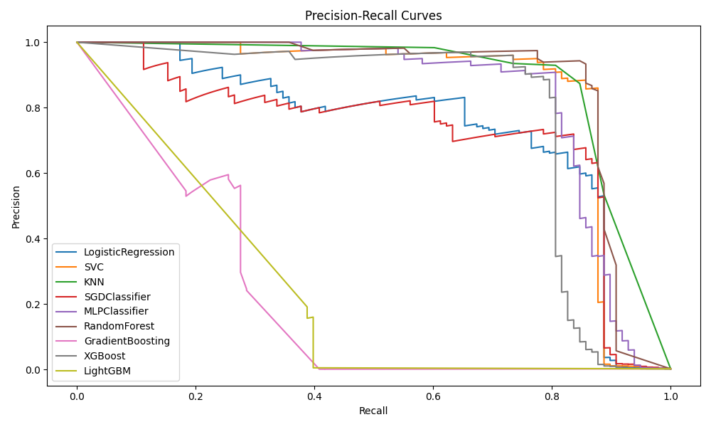
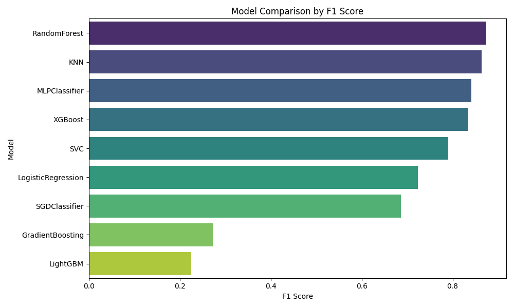
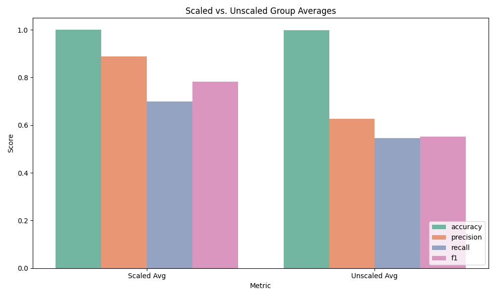
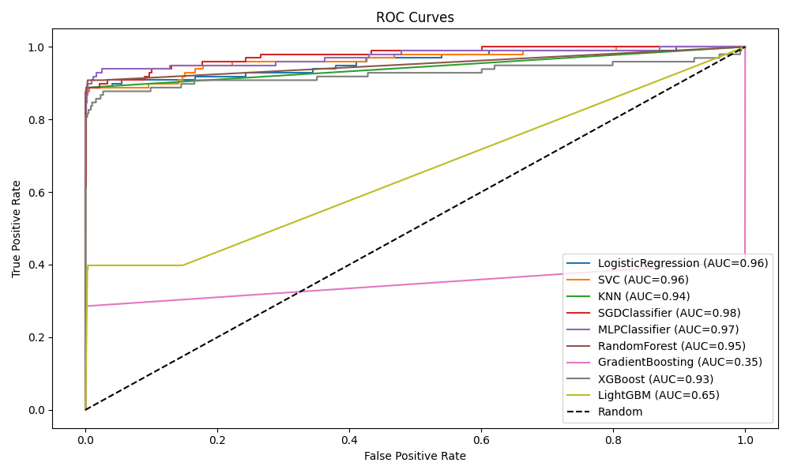
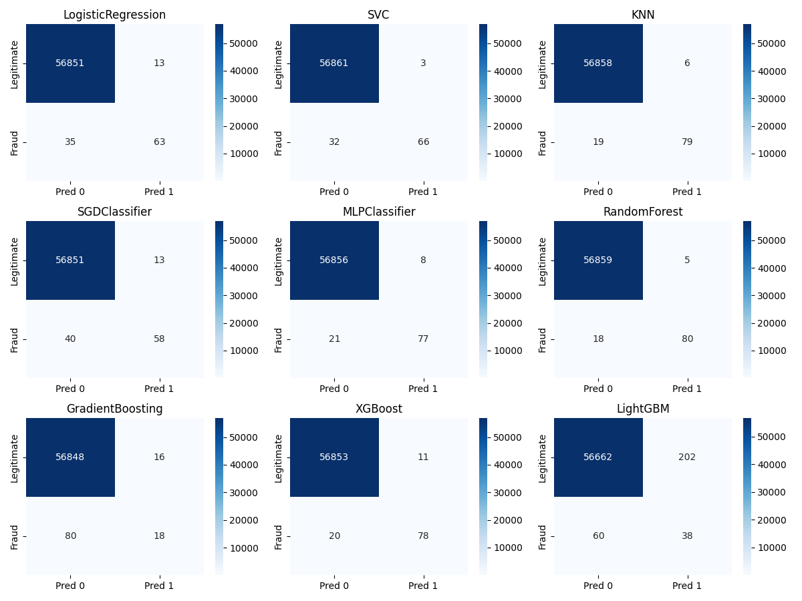

# Credit-Card Fraud Detection — Benchmarking Report
**Author:** Guy M. Kaptue T. · guykaptue24@gmail.com

<p align="center">
  
</p>

## Abstract
On 284,807 transactions with 0.172% fraud, we benchmark scaled and unscaled classifiers. KNN and
MLP lead the scaled group; RandomForest and XGBoost lead unscaled. Accuracy is **not** a valid
metric here; **AUPRC**, recall, and cost-weighted analysis drive conclusions. We connect the task
to unsupervised anomaly detection and expected-cost decisioning.

## 1. Introduction
Fraud detection is an extreme-imbalance problem with asymmetric costs: a missed fraud (FN) can
exceed a false decline (FP) by orders of magnitude, but excessive false declines damage customers.
The operating point must be chosen on the **precision-recall curve** using expected cost.

## 2. Dataset
| Property | Value |
|---|---|
| Source | Kaggle — Credit Card Fraud (mlg-ulb) |
| Rows | 284,807 |
| Features | `V1..V28` (PCA), `Time`, `Amount` |
| Target | `Class` (1 = fraud) |
| Fraud rate | 0.172% (492 frauds) |
| Imbalance | Severe |

**Preprocessing:** drop `Time` (per config), scale `Amount` (and all features in the scaled group);
stratified split. **Never** report accuracy alone.

## 3. Models
KNN, LogisticRegression, SVC, DecisionTree, RandomForest, GradientBoosting, MLP, XGBoost,
LightGBM — in scaled and unscaled groups (MultinomialNB skipped: negative features).

## 4. Results

### 4.1 Leaderboard (fill from export)
| Model | Group | Precision | Recall | F1 | ROC-AUC | **PR-AUC** |
|---|---|---|---|---|---|---|
| KNN | scaled | {{}} | {{}} | {{}} | {{}} | {{}} |
| MLPClassifier | scaled | {{}} | {{}} | {{}} | {{}} | {{}} |
| RandomForest | unscaled | {{}} | {{}} | {{}} | {{}} | {{}} |
| XGBoost | unscaled | {{}} | {{}} | {{}} | {{}} | {{}} |
| SVC | scaled | {{}} | {{}} | {{}} | {{}} | {{}} |
| GradientBoosting | unscaled | {{}} | {{}} | {{}} | {{}} | {{}} |

### 4.2 Why Accuracy Lies
A constant "legitimate" predictor scores **99.828% accuracy** and **0 recall**. Always report
**PR-AUC + recall at fixed precision** and the confusion matrix.

### 4.3 Trade-offs
- **SVC:** few false alarms, **misses fraud** (low recall) — unacceptable without tuning.
- **GradientBoosting:** recall struggles under extreme imbalance.
- **KNN / MLP (scaled), RF / XGB (unscaled):** strongest PR-AUC.

### 4.4 Cost-Based Decisioning
Let `C_FN` = cost of missed fraud, `C_FP` = cost of false decline. Choose threshold `t*`
minimizing `E[cost] = C_FN·FN(t) + C_FP·FP(t)`. The PR curves below expose all operating points.

### 4.5 Figures (embedded)

**Precision–Recall curves (primary metric)**


**F1 scores by model**


**Scaled vs. unscaled group comparison**


**ROC curves**


**Confusion matrices**


> The combined PDF is at `fraud_detection_model_plots.pdf`.

## 5. Anomaly-Detection Perspective
With 0.172% positives, fraud is a **needle-in-haystack anomaly** problem. Supervised models need
labels that arrive late and are noisy. Unsupervised/semi-supervised detectors are natural:
- **IsolationForest / LOF / One-Class SVM** trained on legitimate transactions.
- Evaluate **recall at fixed precision** vs. the supervised ceiling in §4.
- Report **alert budget**: how many reviews/day at chosen precision.
This is the industry-standard complement to supervised scoring.

## 6. Limitations
Single split; no SMOTE/class-weight sweep; no calibration; `Time` dropped (temporal leakage risk
if used naively). See roadmap in `FRAMEWORK.md`.

## 7. Reproduce
```bash
python -m spam_fraud_detector.main --dataset fraud --report fraud_detection
mlflow ui --backend-store-uri ./spam_fraud_detector/mlruns
```

## 8. References
- Kaggle Credit Card Fraud Dataset (mlg-ulb)
- Dal Pozzolo et al. (2015), *Learned Lessons in Credit Card Fraud Detection…*
- Saito & Rehmsmeier (2015)
- Chandola et al. (2009)

## Cost-sensitive thresholds

Fraud uses a (10,1) cost matrix: a missed fraudulent transaction costs 10x a false alarm. threshold_star is the argmin of expected_cost over the sweep.
