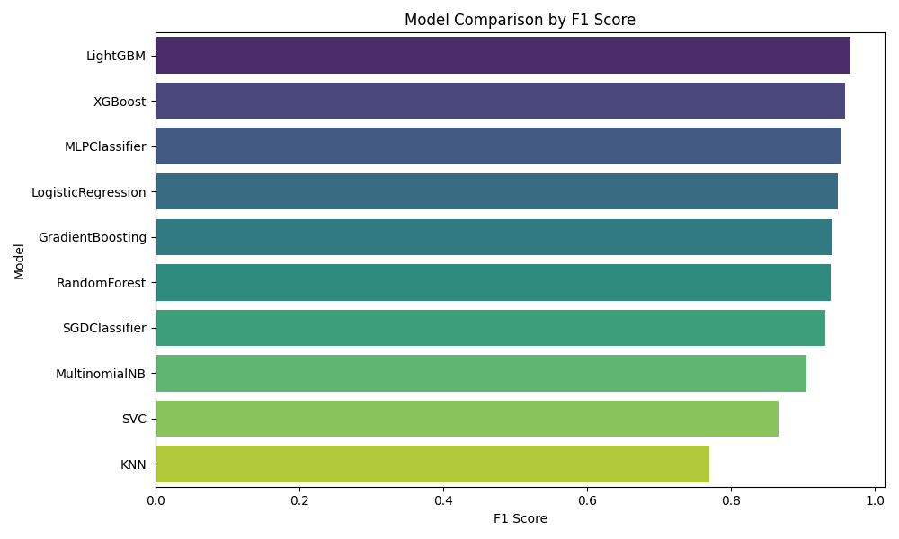
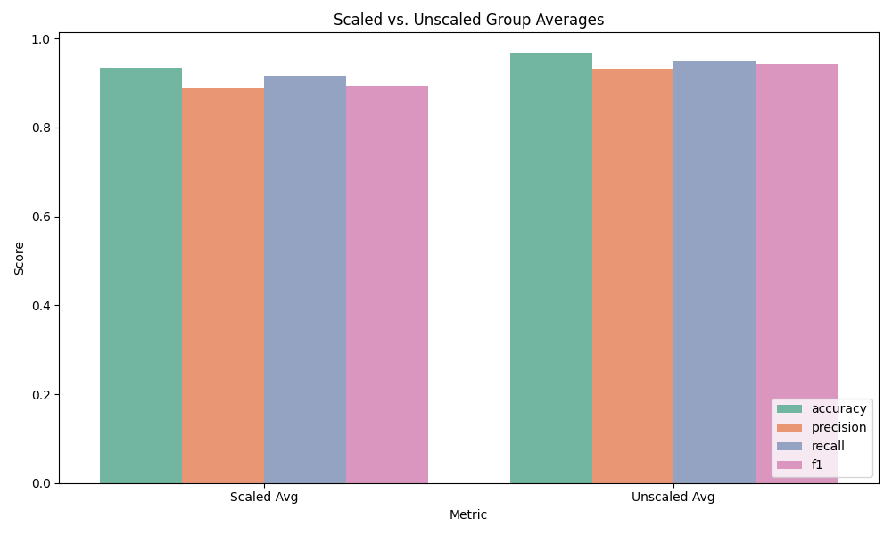
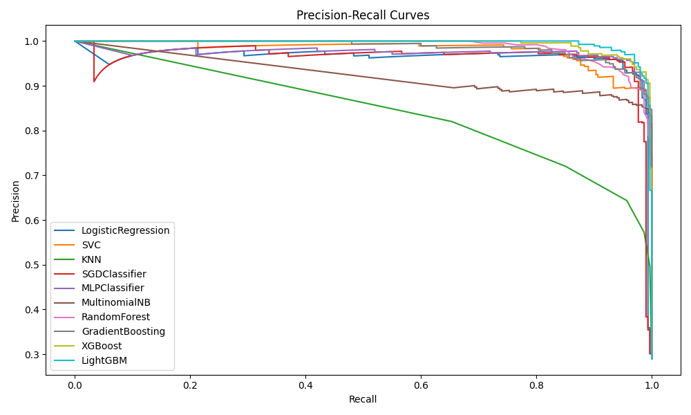
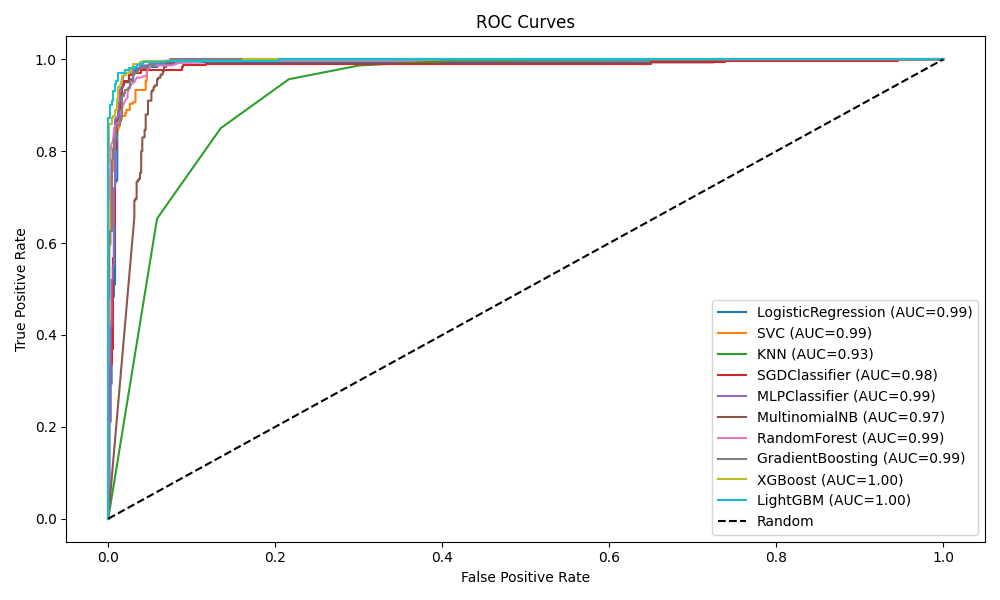
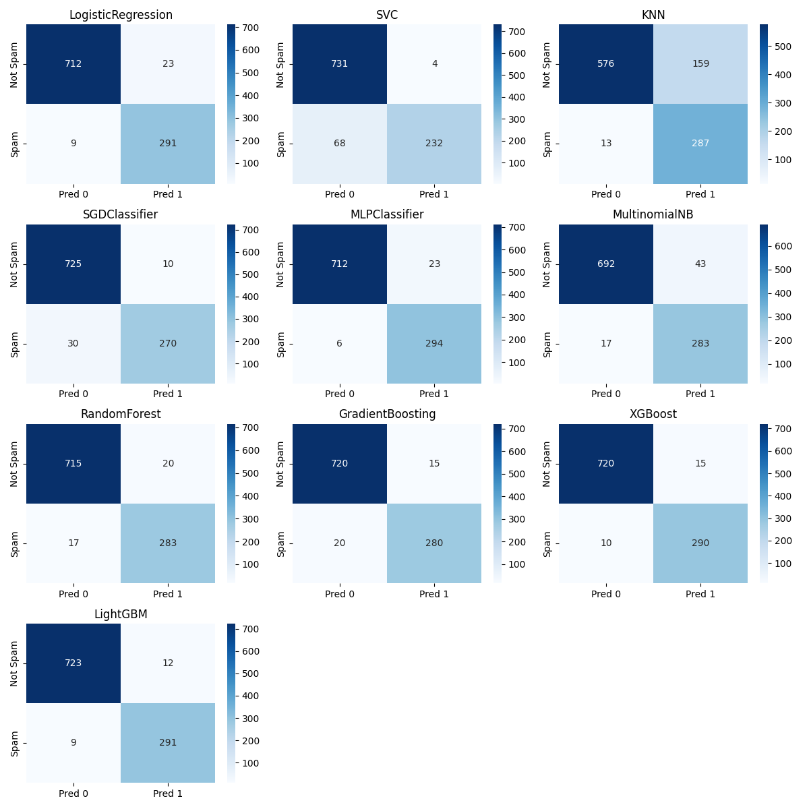

# Spam Detection — Benchmarking Report
**Author:** Guy M. Kaptue T. · guykaptue24@gmail.com

<p align="center">
  
</p>

## Abstract
We benchmark ten+ classifiers, scaled and unscaled, on 5,172 labeled emails (3,000 word-count
features, ~29% spam). LogisticRegression and MLP lead the scaled group; LightGBM and XGBoost lead
the unscaled group. SVC is precision-oriented (cautious) while KNN is recall-oriented (aggressive).
We frame spam filtering as supervised anomaly detection and discuss operational trade-offs.

## 1. Introduction
Spam filtering is a high-volume binary decision problem where **false positives (blocked legitimate
mail) are costly** and false negatives (delivered spam) are annoying but cheaper. The optimal
operating point is therefore precision-leaning, but must retain recall.

## 2. Dataset
| Property | Value |
|---|---|
| Source | Kaggle — Spam Mails Dataset (venky73) |
| Rows | 5,172 |
| Features | Email ID + 3,000 word counts |
| Target | `Prediction` (1 = spam, 0 = ham) |
| Spam rate | ~29% |
| Imbalance | Moderate |

**Preprocessing:** drop ID; optional StandardScaler for the *scaled* group; stratified 80/20 split.

## 3. Models
LogisticRegression, KNN, SVC, DecisionTree, RandomForest, GradientBoosting, MLPClassifier,
MultinomialNB (valid here — non-negative counts), XGBoost, LightGBM. Two groups: **scaled** and **unscaled**.

## 4. Results

### 4.1 Leaderboard (fill from Excel export / MLflow)
| Model | Group | Accuracy | Precision | Recall | F1 | ROC-AUC | PR-AUC |
|---|---|---|---|---|---|---|---|
| LogisticRegression | scaled | {{}} | {{}} | {{}} | {{}} | {{}} | {{}} |
| MLPClassifier | scaled | {{}} | {{}} | {{}} | {{}} | {{}} | {{}} |
| LightGBM | unscaled | {{}} | {{}} | {{}} | {{}} | {{}} | {{}} |
| XGBoost | unscaled | {{}} | {{}} | {{}} | {{}} | {{}} | {{}} |
| SVC | scaled | {{}} | {{}} | {{}} | {{}} | {{}} | {{}} |
| KNN | scaled | {{}} | {{}} | {{}} | {{}} | {{}} | {{}} |

> Source of truth: `spam_detection_model_plots.pdf`, the Excel export,
> and per-run `mlruns/0/*/artifacts/confusion_matrix.json`.

### 4.2 Trade-off Interpretation
- **SVC (cautious):** high precision, low recall → few false blocks, but spam slips through.
- **KNN (aggressive):** high recall, low precision → catches spam, but more false blocks.
- **LogReg / MLP (scaled):** best F1 balance.
- **LightGBM / XGBoost (unscaled):** strong tree-based baselines without scaling.

### 4.3 Figures (embedded)

**F1 scores by model**


**Scaled vs. unscaled group comparison**


**Precision–Recall curves**


**ROC curves**


**Confusion matrices**


> The combined PDF is at `spam_detection_model_plots.pdf`.

## 5. Anomaly-Detection Perspective
Spam is the **minority/undesired** class. Supervised results above define the performance ceiling
for **semi-supervised anomaly detection** (train on ham only, flag outliers as spam). Recommended
comparison: One-Class SVM / IsolationForest trained on ham → measure recall at matched precision.
This reframes spam filtering as *novelty detection* and is valuable when spam evolves (concept drift).

## 6. Limitations
Single split; default 0.5 threshold; no calibration. Bag-of-words features (no semantics).

## 7. Reproduce
```bash
python -m spam_fraud_detector.main --dataset spam --report spam_detection
mlflow ui --backend-store-uri ./spam_fraud_detector/mlruns
```

## 8. References
- Kaggle Spam Mails Dataset (venky73)
- Saito & Rehmsmeier (2015), *The Precision-Recall Plot Is More Informative than the ROC Plot…*
- Chandola et al. (2009), *Anomaly Detection: A Survey*
